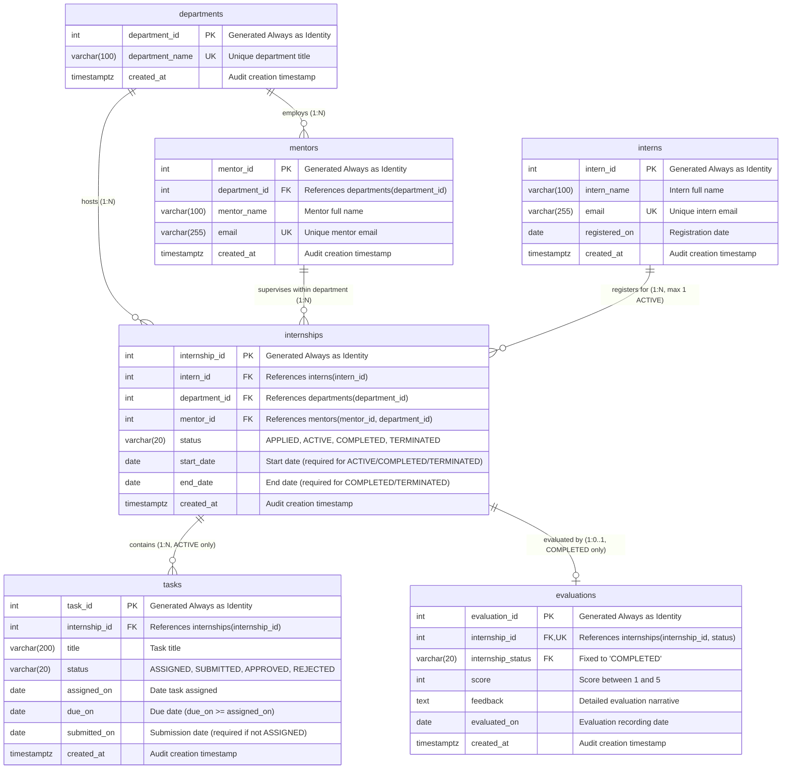

# Entity Relationship Diagram

The following Mermaid diagram visualizes the RabTech Internship Relational Model schema, including Primary Keys (`PK`), Foreign Keys (`FK`), Unique Keys (`UK`), and composite constraints.

## Key Constraint Details

1. **Composite Key on `mentors`**:
   - `UNIQUE (mentor_id, department_id)` provides the target for BR2 composite foreign key.
2. **Composite Key on `internships`**:
   - `UNIQUE (internship_id, status)` provides the target for BR5 composite foreign key.
3. **Partial Unique Index on `internships`**:
   - `CREATE UNIQUE INDEX uq_internships_active_per_intern ON internships (intern_id) WHERE (status = 'ACTIVE');` (BR1).
4. **Declarative State Filter on `evaluations`**:
   - `internship_status VARCHAR(20) NOT NULL DEFAULT 'COMPLETED' CHECK (internship_status = 'COMPLETED')` paired with composite foreign key `(internship_id, internship_status) REFERENCES internships(internship_id, status)` guarantees evaluations can only ever be attached to `COMPLETED` internships.
